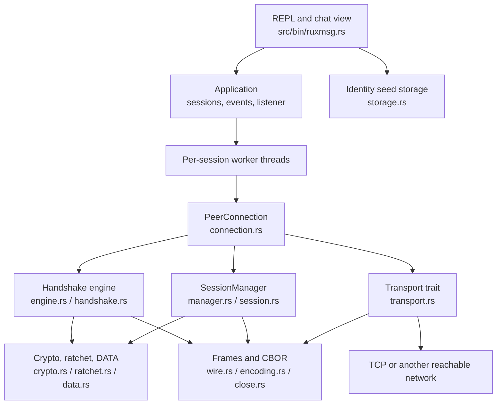

# RUXMSG architecture

This document explains how the implementation is organized. It is explanatory, not normative. For wire behavior and security requirements see the [RUXMSG/1 specification](protocol-spec.md). Where the code does not yet meet spec 1.1, this guide says so and points to the [conformance matrix](conformance-matrix.md).

## System boundary

RUXMSG/1 is a volatile two-party messaging library and terminal client. The network is hostile: TCP, Tailscale, or another transport provides reachability only. Identity, authentication, confidentiality, integrity and replay protection are provided above it. RUXMSG/1 has no groups, anonymity layer, relay, trust store or history; those are RUXMSG/2 topics.

## Layer responsibilities

### Identity

`identity.rs` models the 32-byte Ed25519 public identity. `crypto::IdentityKeypair` owns the private seed. `storage.rs` persists exactly that seed through an OS credential store. There is no peer record, trust state or address book. Receiving a public key changes nothing on disk, and no identity is remembered between connections.

### Handshake and transcript

`handshake.rs` defines the handshake payloads and `encoding.rs` defines the transcript. `engine.rs` drives both roles over a `Transport`. Spec 1.1 flow:

1. initiator sends COMMIT, a hash of its yet-unrevealed HELLO;
2. responder sends its HELLO;
3. initiator reveals its HELLO; the responder verifies it against the commitment;
4. both build the deterministic transcript from the two HELLOs and derive the SAS;
5. both users compare and approve the SAS (initial handshakes only);
6. initiator then responder sign the transcript hash with Ed25519, each side checking the AUTH fields against its own transcript;
7. both derive session keys with X25519 and HKDF-SHA-256;
8. both exchange confirmation MACs, and only then is a session established.

The COMMIT step exists so that an active attacker cannot choose its values after seeing the other side's and grind the 33-bit SAS. The transcript excludes signatures. *Status: steps 1 to 3 and the local-transcript check in step 6 are planned; the rest is implemented.*

### Sessions and message protection

`manager.rs` owns the active session and, during a rekey drain, one draining predecessor. `session.rs` enforces lifecycle transitions and rekey timing. `ratchet.rs` holds the receiving chain, replay window and bounded key cache. `data.rs` pads, encrypts, decrypts and validates DATA. `crypto.rs` holds primitive composition, nonce and key derivation.

Receive order matters: replay classification, key **prepare** (cache without consuming), AEAD decrypt, plaintext and padding validation, then **commit** (consume key, record counter). A forged frame therefore cannot burn a legitimate message's key.

Only the active session originates DATA. A draining session accepts eligible in-flight DATA for 15 seconds.

### Rekey

Either peer may start a rekey, using the same handshake with the REKEY frame type. A rekey does not use SAS. It is authenticated by identity continuity: the candidate must name the active session as its predecessor and present the same identities that authenticated it. A failed candidate is discarded and the old session returns to ACTIVE. *Status: rekey primitives and a synchronous rekey exist; identity continuity, failure recovery, peer-initiated handling in the reader loop, and the automatic trigger are planned.*

### Wire and transport

`wire.rs` implements the six-byte frame header and strict payload limits, and canonical CBOR validation (malformed, non-canonical, duplicate-key, unknown-key and trailing-byte input is rejected). `transport.rs` provides:

- `Transport`, the frame-level I/O boundary;
- `InMemoryTransport` for deterministic tests;
- `FramedTransport` over any readable/writable stream;
- `Demuxer`, which buffers DATA and CLOSE frames that arrive while a handshake or rekey is waiting for control frames.

### Connection facade

`PeerConnection<T>` is the single-transport facade: establish a session, send and receive, rekey, expire the drain window, close. For TCP, `split_tcp()` yields a reader half (owns socket reads, handles receive and rekey) and a writer half (sends and closes through a synchronized write clone), so a blocked read never blocks a send. Both halves share one `SessionManager` behind a mutex that is never held across a socket read.

## Client runtime and threads

The binary is a single process holding many independent two-party sessions.

- **Main thread**: raw-mode REPL loop, or the Ratatui chat view. It drains a single `NetEvent` channel and sends `SessionCommand`s to workers.
- **Listener thread**: non-blocking accept loop started by `start`; spawns a worker per incoming connection.
- **Per-session worker**: runs the handshake (calling out to the UI for SAS approval over a channel), splits the TCP stream, then runs a reader loop; a paired writer thread executes `Send` and `Close` commands.
- **Shared state**: a mutex-guarded label-to-`PeerHandle` map (address, fingerprint, status, command sender).

Session lifetime equals connection lifetime: when a reader loop ends, the session entry is removed and its keys drop.

## State and persistence boundary

Persistent:

- the local Ed25519 identity seed, in the OS credential store (service `ruxmsg-<profile>`, account `identity`).

Volatile (memory only):

- peer identities, fingerprints, addresses and approvals;
- ephemeral X25519 private keys;
- session keys, chains, message keys, replay windows, skipped keys, counters;
- session lifecycle state, messages and any chat scrollback.

A process exit or transport loss destroys the session. Reconnecting always means a fresh handshake and SAS. No state carries between connections, so counters and nonces never need continuity across them.

## Known gaps against spec 1.1

Key material hygiene (initial directional keys retained in `ManagedSession`, chain keys not zeroized), display sanitization, timeouts and caps are open items; see the [conformance matrix](conformance-matrix.md).
