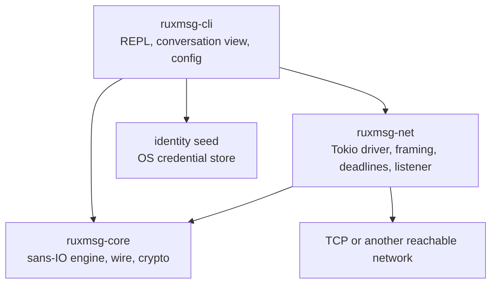

# RUXMSG architecture

This document explains how the implementation is organized. It is explanatory, not normative. For wire behavior and security requirements see the [RUXMSG/1 specification](protocol-spec.md). Where the code does not yet meet spec 1.1, this guide says so and points to the [conformance matrix](conformance-matrix.md).

## System boundary

RUXMSG/1 is a volatile two-party messaging library and terminal client. The network is hostile: TCP, Tailscale, or another transport provides reachability only. Identity, authentication, confidentiality, integrity and replay protection are provided above it. RUXMSG/1 has no groups, anonymity layer, relay, trust store or history; those are RUXMSG/2 topics.

| Crate | Owns | Must not contain |
| --- | --- | --- |
| `ruxmsg-core` | frames and CBOR, handshake payloads, crypto, ratchets, DATA, the `Engine` state machine, display sanitizing, the `SecretStore` trait | sockets, threads, clocks, a runtime, a terminal, an OS credential store (a test asserts its manifest) |
| `ruxmsg-net` | one Tokio task per connection, the frame decoder, deadlines, bounded queues, the listener and its handshake cap | protocol decisions, UI, storage |
| `ruxmsg-cli` | the REPL, the conversation view, SAS prompts, key bindings, the read-only config loader, the keyring adapter, process hardening | protocol logic |

## Layer responsibilities

### Identity

`identity.rs` models the 32-byte Ed25519 public identity. `crypto::IdentityKeypair` owns the private seed. `storage.rs` persists exactly that seed through an OS credential store. There is no peer record, trust state or address book. Receiving a public key changes nothing on disk, and no identity is remembered between connections.

### Handshake and transcript

`handshake.rs` defines the handshake payloads and `encoding.rs` defines the transcript. `machine.rs` drives both roles as a sans-IO state machine. Spec 1.1 flow:

1. initiator sends COMMIT, a hash of its yet-unrevealed HELLO;
2. responder sends its HELLO;
3. initiator reveals its HELLO; the responder verifies it against the commitment;
4. both build the deterministic transcript from the two HELLOs and derive the SAS;
5. both users compare and approve the SAS (initial handshakes only);
6. initiator then responder sign the transcript hash with Ed25519, each side checking the AUTH fields against its own transcript;
7. both derive session keys with X25519 and HKDF-SHA-256;
8. both exchange confirmation MACs, and only then is a session established.

Exact order (initial uses HANDSHAKE frames, rekey uses REKEY frames):

| # | Sender | Frame | Receiver action |
| ---: | --- | --- | --- |
| 1 | initiator | COMMIT | validate version, suite, purpose and `previous_session_id`; store the commitment |
| 2 | responder | HELLO | check role, suite, purpose and previous session against the sent COMMIT; reject own identity or ephemeral |
| 3 | initiator | HELLO (reveal) | hash the exact payload bytes, constant-time compare to the commitment, match the COMMIT fields, reject own identity or ephemeral |
| 4 | both | (local) | build transcript, hash and SAS (initial) |
| 5 | initiator | AUTH stage 0 | sent after SAS approval (initial) or immediately (rekey); the responder verifies Sig_I against its own transcript |
| 6 | responder | AUTH stage 1 | sent only after Sig_I verifies; the initiator verifies Sig_R |
| 7 | initiator, then responder | SESSION_CONFIRM | verify the MAC in constant time and the sender's role; ACTIVE after both |

COMMIT is sent only by the initiator, first. It authenticates nothing cryptographically: it binds the initiator to the exact bytes of its later HELLO.

Forbidden before validation (any violation aborts the candidate and sends no further handshake frame):

- a responder HELLO before a valid COMMIT, and an initiator HELLO before the responder HELLO;
- the transcript, SAS or key derivation before both HELLOs are present and the commitment has verified;
- any AUTH signature before SAS approval (initial) or before both HELLOs verify (rekey);
- Sig_R before Sig_I verifies against the locally built transcript;
- SESSION_CONFIRM before AUTH completes, and DATA before ACTIVE;
- a second COMMIT or HELLO, a frame of the wrong type for the purpose, or any frame out of sequence.

The one legal early frame is the initiator's AUTH arriving while the responder's human is still reading the SAS; the engine holds that single frame until the decision. These cases are tested in `crates/ruxmsg-core/tests/engine.rs`.

The COMMIT step exists so that an active attacker cannot choose its values after seeing the other side's and grind the 33-bit SAS. The transcript excludes signatures. Signature verification is strict (non-canonical signatures and small-order keys are rejected).

### Sessions and message protection

The engine owns the active session and, during a rekey drain, one draining predecessor. `ratchet.rs` holds the receiving chain, replay window and bounded key cache. `data.rs` pads, encrypts, decrypts and validates DATA. `crypto.rs` holds primitive composition, nonce and key derivation.

Receive order matters: replay classification, key **prepare** (cache without consuming), AEAD decrypt, plaintext and padding validation, then **commit** (consume key, record counter). A forged frame therefore cannot burn a legitimate message's key.

Only the active session originates DATA. A draining session accepts eligible in-flight DATA for 15 seconds.

### Rekey

Either peer may start a rekey (24 h after activation, after 1,000,000 messages, or on request), using the same handshake with the REKEY frame type. A rekey does not use SAS. It is authenticated by identity continuity: the candidate must name the active session as its predecessor and present the same identities that authenticated it. A failed candidate is discarded and the old session returns to ACTIVE. Simultaneous rekeys are resolved by comparing raw identity keys.

### Wire and framing

`wire.rs` implements the six-byte frame header, per-type payload limits and canonical CBOR validation (malformed, non-canonical, duplicate-key, unknown-key and trailing-byte input is rejected). Version, type and length are checked from the header before any payload is read. Reading frames off a stream is the net layer's `FrameDecoder`.

## Sans-IO engine (`crates/ruxmsg-core/src/machine.rs`)

`Engine::handle(Input) -> Vec<Effect>` is the protocol core. It is the only implementation of the handshake and session logic; the earlier blocking implementation has been removed.

- **No ambient dependencies.** The engine has no clock, socket, thread, runtime handle or UI callback (enforced by a source check in `crates/ruxmsg-core/tests/engine.rs`). Randomness is the injected `Entropy` trait.
- **Inputs:** `Start`, `FrameReceived`, `SasDecision`, `LocalSend`, `LocalClose`, `RequestRekey`, `Timeout(DeadlineId)`, `TransportClosed`.
- **Effects, applied in the order returned:** `Send`, `SetDeadline`, `CancelDeadline`, `RequestSas`, `Deliver`, `Notify`, `CloseTransport`. A `Send` that precedes `CloseTransport` must be written first.
- **Deadlines are effects.** The engine asks for one with `SetDeadline { id, kind, after }` and learns of expiry through `Timeout(id)`. A `Timeout` for an id the engine no longer has armed is ignored, so a timer that raced a cancellation is harmless.
- **Closed is terminal.** Every input after `CloseTransport` returns no effects.

### Timeout policy

| Deadline | Armed | Expiry |
| --- | --- | --- |
| Frame, 15 s | while waiting for COMMIT, HELLO, reveal or confirmation; for rekey, every wait | initial: close; rekey: abort the candidate only |
| SAS, 120 s | while the local human decides | close (treated as rejection) |
| Total, 180 s | whole handshake or rekey | initial: close; rekey: abort the candidate only |
| Rekey due, 24 h | after each activation | begin a rekey |
| Rekey retry, 30 s | after a failed rekey (not in the spec) | begin a rekey |
| Drain, 15 s | after promotion | destroy the draining session |

Spec §11 gives a 15 s per-frame read timeout and a 120 s SAS timeout without saying how they interact. A peer waiting for our AUTH cannot tell a slow human from a dead link, so the 15 s deadline is **not** armed while the peer may still be in its SAS wait (after the HELLOs, before AUTH is exchanged); the 180 s total bounds that span instead. This reading is an implementation decision and should be confirmed in the spec.

A rekey timeout aborts the candidate and never closes the session. A later REKEY or SESSION_CONFIRM frame that belongs to an aborted attempt is out of sequence and ends the session; both peers time out on the same schedule, so an honest peer does not send one.

### Cancellation and partial writes (driver contract)

`select!` cancellation does not roll back protocol state, so only the engine mutates state, and only inside `handle`. Reads and writes are never raced in a `select!` arm. A frame read keeps its partial buffer across iterations. Once the first byte of a frame is written, the write runs to completion or the connection is treated as lost (`TransportClosed`); a partially written frame is never treated as unsent.

## Client runtime

The binary is one single-threaded Tokio task set holding many independent two-party sessions.

- **UI task** (`crates/ruxmsg-cli/src/app.rs`): owns the terminal, the peer table, scrollbacks and the SAS queue. One `select!` multiplexes key events, the bounded `NetEvent` channel, a 250 ms tick and termination signals.
- **Net layer** (`crates/ruxmsg-net/src/lib.rs`): one task per connection owns its `Engine`; one task per listener accepts and applies the cap of four unauthenticated handshakes. Commands go in through bounded channels; events come out through one bounded channel.
- **Modes:** the REPL (raw mode, prompt redrawn under asynchronous output) and one conversation at a time in the alternate screen. SAS is typed (`yes` + Enter) in either.
- **Blocking work** (keyring access, `tailscale` commands) runs on the blocking pool.

Session lifetime equals connection lifetime: when a connection task ends, its `Closed` event removes the entry and its scrollback is zeroized.

### Cancellation in the net layer

The `select!` in a connection task has only cancel-safe branches: a `read` into a scratch buffer, two channel receives and a sleep. A partial frame lives in `FrameDecoder` across iterations. Writes are awaited outside the `select!` under a 15 s timeout; an error or timeout is treated as a lost connection because part of a frame may be on the wire. Bounds: message queue 64, control queue 8, event queue 256, decoder buffer one frame plus one read chunk, SAS queue 4, unauthenticated handshakes 4.

## State and persistence boundary

Persistent:

- the local Ed25519 identity seed, in the OS credential store (service `ruxmsg-<profile>`, account `identity`).

Volatile (memory only):

- peer identities, fingerprints, addresses and approvals;
- ephemeral X25519 private keys;
- session keys, chains, message keys, replay windows, skipped keys, counters;
- session lifecycle state, messages and any chat scrollback.

A process exit or transport loss destroys the session. Reconnecting always means a fresh handshake and SAS. No state carries between connections, so counters and nonces never need continuity across them.

## Known gaps against spec 1.1

Published known-answer vectors, recorded fuzzing runs, memory locking, and automated tests for zeroization and the exit wipe are open items; see the [conformance matrix](conformance-matrix.md).
